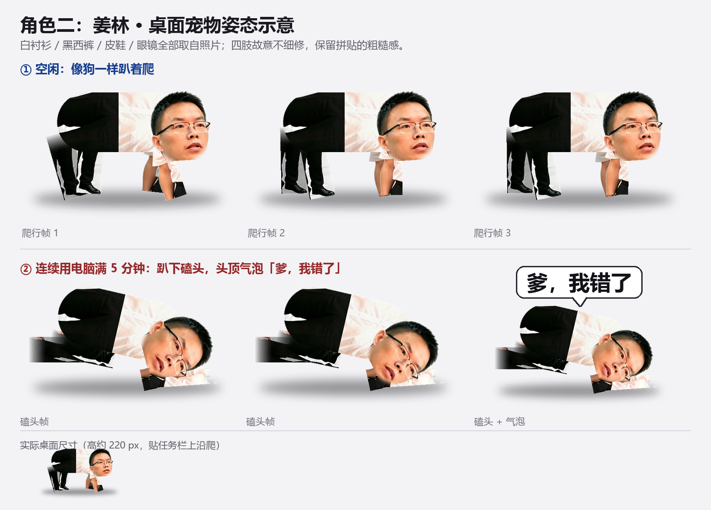
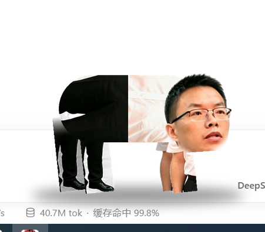

# DeskPet · 姜林（Jiang Lin）

> A tiny desktop pet of **Jiang Lin** — he crawls on all fours, and kowtows with a speech bubble after 5 minutes of non-stop computer use.

这是同一个桌宠框架的**第二个角色**：白衬衫 / 黑西裤 / 皮鞋 / 眼镜的姜林。

他的行为和一个蓝球衣角色完全一致：**空闲时像狗一样在桌面底部爬**，**连续用电脑满 5 分钟就趴下磕头**，头顶冒出气泡「爹，我错了」。

素材全部来自两张照片（全身照做姿态、头像做图标），四肢故意不细修，保留粗糙的拼贴感。





---

## ✨ 特性

- **两个状态**：`爬行`（4 帧对角步态）/ `磕头`（3 帧，躯干下压、头砸地 + 气泡）
- **连续使用检测**：系统级 `GetLastInputInfo` 判断「连续在用电脑」，满 5 分钟触发，离开 30 秒自动清零
- **逐像素透明窗口**：`WS_EX_LAYERED` + `UpdateLayeredWindow`；**透明区域鼠标穿透**
- **托盘 + 任务栏**：托盘常驻图标（双击收起/叫出），任务栏独立按钮，标题显示「姜林」
- **右键菜单**：动作（爬来爬去 / 磕一个 / 连磕三个 / 原地休息 / 掉个头）、暂停、收起、置顶、开机自启、退出
- **左键拖动**、**单实例**、**DPI 感知**
- **绿色单文件 exe**，不联网、不写系统目录
- **兼容 Windows 7 SP1 32 位**：系统自带 .NET Framework 3.5 + `csc.exe`，编译成 x86 单文件

## 🚀 快速开始

1. 下载仓库根目录的 `DeskPet.exe`（或从 Releases 下载，或自行编译）；
2. 双击运行，姜林出现在屏幕底部开始爬；
3. 右键他或托盘图标 → 菜单。

> 想马上看磕头：`DeskPet.exe --dev`（阈值 5 分钟 → 15 秒）。

### 自己编译

双击 `build.bat`（无需 Visual Studio，用系统自带 `csc.exe`）：

```
build.bat        →  build\DeskPet.exe
```

脚本自动查找 `%WINDIR%\Microsoft.NET\Framework\`（优先 v3.5，其次 v2.0/v4.0）。

## 🖥 系统要求

| 项目 | 要求 |
|---|---|
| 系统 | Windows 7 SP1 及以上（32/64 位） |
| 运行时 | .NET Framework 3.5（Win7 自带；未启用则在「启用或关闭 Windows 功能」里勾选） |
| 其它 | 无第三方依赖 |

## 🖱 使用说明

| 操作 | 效果 |
|---|---|
| 左键拖动 | 拖走 |
| 右键宠物 / 托盘图标 | 同一套菜单 |
| 双击托盘图标 | 收起 / 叫出 |
| 任务栏按钮的最小化 | 收起（不是白框） |

菜单项：

```
动作 ▸ 爬来爬去（默认）/ 磕一个 / 连磕三个 / 原地休息 / ─── / 掉个头
暂停爬行
收起姜林
始终置顶 ✔
开机自启 ☐
退出姜林
```

## ⌨️ 命令行参数

| 参数 | 说明 |
|---|---|
| `--dev` | 阈值 5 分钟 → 15 秒，并忽略空闲判定 |
| `--debug` | 日志写入 `%TEMP%\DeskPet.log` |
| `--selftest` | 不显示窗口，只导出渲染结果到 `%TEMP%\deskpet_selftest_*.png` |

## 🔧 自定义

| 想改什么 | 改哪里 |
|---|---|
| 磕头间隔 / 连续阈值 | `src/PetForm.cs` → `FiveMinutes` / `IdleReset` |
| 气泡文字 | `src/Sprites.cs` → `MakeBubble("爹，我错了")` |
| 爬行速度 / 步态帧率 | `src/PetForm.cs` → `MoveCrawl()` |
| 宠物大小 | `tools/build_sprites.py` → `H_PX` |
| 显示名 | `assets/petname.txt` |

## 🎨 素材是怎么来的

```
assets/source.jpg（白底全身照）
   │  tools/cutout.py       GrabCut + 白底漫水填充，右下角水印清除
   ▼
build/cutout.png
   │  tools/rig.py          拆件：头 / 白衬衫 / 胳膊 / 裤腿（含皮鞋）
   │                        头与腿水平翻转、衬衫右转 90°、拼成狗爬 & 磕头
   ▼
assets/sprites/crawl_0..3.png + kowtow_0..2.png    ← tools/build_sprites.py
assets/sprites/icon.ico                            ← tools/make_icon.py（头像 → 圆角 ico）
```

依赖：`pip install pillow opencv-python numpy`

```bat
python tools\cutout.py
python tools\build_sprites.py
python tools\make_icon.py
build.bat
```

> `tools/rig.py` 里的裁切框是按这张照片量的坐标，换别人照片需要重新调（可以用按行扫描 alpha 的办法量，见文件顶部注释）。

## 📁 目录结构

```
DeskPet-JL/
├─ build.bat                一键编译（输出 build\DeskPet.exe）
├─ src/                     C# 源码（本角色与另一角色共用同一套代码）
│   ├─ Program.cs           入口、单实例、日志、自检、显示名
│   ├─ Native.cs            Win32 互操作
│   ├─ Sprites.cs           帧加载 / 镜像 / 合成 / 气泡
│   └─ PetForm.cs           窗口、状态机、托盘、菜单
├─ assets/
│   ├─ source.jpg           全身照（做姿态）
│   ├─ portrait.jpg         头像（做图标，带「姜林」红字）
│   ├─ petname.txt          显示名「姜林」
│   └─ sprites/             成品帧 + icon.ico
├─ tools/                   Python 素材脚本
└─ docs/                    预览图 / 截图 / 图标
```

## 🧠 实现要点

- **透明窗口**：`WS_EX_LAYERED` + `UpdateLayeredWindow`，每帧 ARGB → 预乘 BGRA → `CreateDIBSection` 内存 DC。
- **鼠标穿透**：`WM_NCHITTEST` 按当前帧 alpha 判断，透明像素返回 `HTTRANSPARENT`。
- **连续使用判定**：每秒 `GetLastInputInfo`；输入间隔 < 30 秒算连续，满 5 分钟磕头并清零。
- **单实例**：Mutex 名带 exe 文件名，所以不同角色的 exe 可以同时存在、同时运行。

## ⚠️ 已知限制

- 只在**主屏**活动，多显示器需要小改。
- 磕头判定把看视频/打游戏也算「在用电脑」，可调 `IdleReset`。
- 素材来自真人照片，仅作演示用途。

## 🔒 隐私

不联网、不读文件内容、不写系统目录；只有勾选「开机自启」时会写 `HKCU\Software\Microsoft\Windows\CurrentVersion\Run`。

## 📄 License

代码以 [MIT](LICENSE) 发布。素材来自作者提供的照片，随仓库仅作示例。
